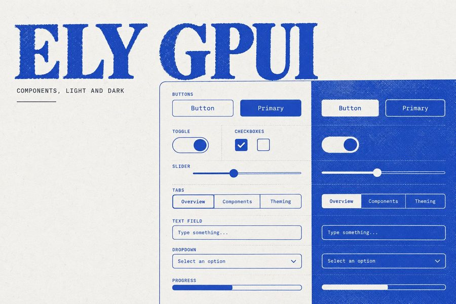
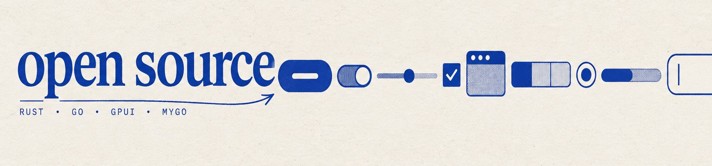

  <b>Native software, built in the open.</b>
   
  Desktop apps, native UI components, terminals and agent tools, mostly in Rust and Go. Built to run on your own machine.

  
  
  
  
  

 

## Projects

<table>
  <tr>
    <td width="50%" valign="top">
      
       <b>Ely Office</b> &nbsp;<code>Rust · GPUI</code> &nbsp;<!--stars:ELY-Open-Source/ElyOffice-->★&nbsp;1,709<!--/stars-->
       Six offline desktop apps: documents, sheets, slides, PDF, Git, and Markdown. Opens Office files. No account, no cloud.
       <a href="https://office.elygpui.com">office.elygpui.com</a> · <a href="https://github.com/ELY-Open-Source/ElyOffice/releases/latest">download</a> · <a href="https://github.com/ELY-Open-Source/ElyOffice">source</a>
    </td>
    <td width="50%" valign="top">
      
       <b>ELY Terminal</b> &nbsp;<code>Rust · GPUI</code> &nbsp;<!--stars:ELY-Open-Source/ELYTerminal-->★&nbsp;476<!--/stars-->
       A terminal for macOS, Windows, and Linux. Sessions on the left, the terminal in the middle, Git or Files on the right.
       <a href="https://github.com/ELY-Open-Source/ELYTerminal/releases/latest">download</a> · <a href="https://github.com/ELY-Open-Source/ELYTerminal">source</a>
    </td>
  </tr>
  <tr>
    <td width="50%" valign="top">
      
       <b>Ely GPUI</b> &nbsp;<code>Rust · Wasm</code> &nbsp;<!--stars:ELY-Open-Source/Ely-GPUI-Components-->★&nbsp;247<!--/stars-->
       1,272 components for GPUI, the Rust framework behind Zed. Light and dark, and every one runs live in the browser.
       <a href="https://elygpui.com">elygpui.com</a> · <a href="https://github.com/ELY-Open-Source/Ely-GPUI-Showcases">showcases</a> · <a href="https://github.com/ELY-Open-Source/Ely-GPUI-Components">source</a>
    </td>
    <td width="50%" valign="top">
      
       <b>Ely Tea Party</b> &nbsp;<code>Rust · GPUI</code> &nbsp;<!--stars:ELY-Open-Source/ely-tea-party-->★&nbsp;17<!--/stars-->
       A terminal where your coding agents come to tea. Each session's agent is an animated chibi girl who types while it works and naps when it's done.
       <a href="https://github.com/ELY-Open-Source/ely-tea-party/releases/latest">download</a> · <a href="https://github.com/ELY-Open-Source/ely-tea-party">source</a>
    </td>
  </tr>
  <tr>
    <td width="50%" valign="top">
      
       <b>Kigi CLI</b> &nbsp;<code>Rust</code> &nbsp;<!--stars:ELY-Open-Source/Kigi-CLI-->★&nbsp;12<!--/stars-->
       A coding agent for the terminal. A planner turns a goal into a dependency graph; workers build nodes in parallel git worktrees; verifiers check each node.
       <a href="https://kigicli.dev">kigicli.dev</a> · <a href="https://github.com/ELY-Open-Source/Kigi-CLI">source</a>
    </td>
    <td width="50%" valign="top">
      
       <b>Agent Company</b> &nbsp;<code>Electron</code> &nbsp;<!--stars:ELY-Open-Source/AgentCompany-->★&nbsp;7<!--/stars-->
       A desktop company of AI agents. Set a goal; a CEO agent builds departments, delegates, and reports back from a pixel office.
       <a href="https://agent-company.dev">agent-company.dev</a> · <a href="https://github.com/ELY-Open-Source/AgentCompany/releases/latest">download</a> · <a href="https://github.com/ELY-Open-Source/AgentCompany">source</a>
    </td>
  </tr>
  <tr>
    <td width="50%" valign="top">
      
       <b>MyGo UI</b> &nbsp;<code>Go · Wasm</code>
       Three component sets for MyGo native Go UI: court-gothic Mujica, 1,500-piece Crychic, and 16-bit pixel 8bit.
       <a href="https://github.com/ELY-Open-Source/MujicaUI">Mujica</a> <!--stars:ELY-Open-Source/MujicaUI-->★&nbsp;27<!--/stars--> · <a href="https://github.com/ELY-Open-Source/CrychicUI">Crychic</a> <!--stars:ELY-Open-Source/CrychicUI-->★&nbsp;66<!--/stars--> · <a href="https://github.com/ELY-Open-Source/8bitMyGoUI">8bit</a> <!--stars:ELY-Open-Source/8bitMyGoUI-->★&nbsp;18<!--/stars-->
    </td>
    <td width="50%" valign="top">
      
       <b>Elysian</b> &nbsp;<code>Python · MCP</code> &nbsp;<!--stars:ELY-Open-Source/Elysian-->★&nbsp;14<!--/stars-->
       A local memory store for AI. Every memory keeps who holds it, where it came from, when it was true, and who may read it.
       <a href="https://github.com/ELY-Open-Source/Elysian">source</a>
    </td>
  </tr>
</table>

 

<table>
  <thead>
    <tr><td colspan="4"></td></tr>
    <tr><th align="left">Repository</th><th align="left">What it is</th><th align="left">Stack</th><th align="right">Stars</th></tr>
  </thead>
  <tbody>
    <tr><td><a href="https://github.com/ELY-Open-Source/ElyOffice"><b>ElyOffice</b></a></td><td>Offline-first desktop office apps</td><td>Rust&nbsp;·&nbsp;GPUI</td><td align="right"><!--stars:ELY-Open-Source/ElyOffice-->★&nbsp;1,709<!--/stars--></td></tr>
    <tr><td><a href="https://github.com/ELY-Open-Source/ELYTerminal"><b>ELYTerminal</b></a></td><td>A terminal on GPUI and Ely</td><td>Rust&nbsp;·&nbsp;GPUI</td><td align="right"><!--stars:ELY-Open-Source/ELYTerminal-->★&nbsp;476<!--/stars--></td></tr>
    <tr><td><a href="https://github.com/ELY-Open-Source/Ely-GPUI-Components"><b>Ely-GPUI-Components</b></a></td><td>1,272 GPUI components, live in the browser</td><td>Rust&nbsp;·&nbsp;Wasm</td><td align="right"><!--stars:ELY-Open-Source/Ely-GPUI-Components-->★&nbsp;247<!--/stars--></td></tr>
    <tr><td><a href="https://github.com/ELY-Open-Source/CrychicUI"><b>CrychicUI</b></a></td><td>1,500 components in MyGo's own look</td><td>Go</td><td align="right"><!--stars:ELY-Open-Source/CrychicUI-->★&nbsp;66<!--/stars--></td></tr>
    <tr><td><a href="https://github.com/ELY-Open-Source/MujicaUI"><b>MujicaUI</b></a></td><td>Court-gothic components for MyGo</td><td>Go</td><td align="right"><!--stars:ELY-Open-Source/MujicaUI-->★&nbsp;27<!--/stars--></td></tr>
    <tr><td><a href="https://github.com/ELY-Open-Source/8bitMyGoUI"><b>8bitMyGoUI</b></a></td><td>16-bit pixel-art components</td><td>Go</td><td align="right"><!--stars:ELY-Open-Source/8bitMyGoUI-->★&nbsp;18<!--/stars--></td></tr>
    <tr><td><a href="https://github.com/ELY-Open-Source/ely-tea-party"><b>ely-tea-party</b></a></td><td>A terminal where coding agents come to tea</td><td>Rust&nbsp;·&nbsp;GPUI</td><td align="right"><!--stars:ELY-Open-Source/ely-tea-party-->★&nbsp;17<!--/stars--></td></tr>
    <tr><td><a href="https://github.com/ELY-Open-Source/Elysian"><b>Elysian</b></a></td><td>Local memory for AI, scoped by who holds it</td><td>Python</td><td align="right"><!--stars:ELY-Open-Source/Elysian-->★&nbsp;14<!--/stars--></td></tr>
    <tr><td><a href="https://github.com/ELY-Open-Source/Kigi-CLI"><b>Kigi-CLI</b></a></td><td>Graph-planned multi-agent coding CLI</td><td>Rust</td><td align="right"><!--stars:ELY-Open-Source/Kigi-CLI-->★&nbsp;12<!--/stars--></td></tr>
    <tr><td><a href="https://github.com/ELY-Open-Source/AgentCompany"><b>AgentCompany</b></a></td><td>A company of AI agents on your desktop</td><td>TypeScript</td><td align="right"><!--stars:ELY-Open-Source/AgentCompany-->★&nbsp;7<!--/stars--></td></tr>
    <tr><td><a href="https://github.com/ELY-Open-Source/OmaPhoto"><b>OmaPhoto</b></a></td><td>Layered photo editor for Linux</td><td>C++&nbsp;·&nbsp;Qt</td><td align="right"><!--stars:ELY-Open-Source/OmaPhoto-->★&nbsp;5<!--/stars--></td></tr>
    <tr><td><a href="https://github.com/ELY-Open-Source/Ely-GPUI-Showcases"><b>Ely-GPUI-Showcases</b></a></td><td>Apps built with Ely GPUI, and how to add yours</td><td>JavaScript</td><td align="right"><!--stars:ELY-Open-Source/Ely-GPUI-Showcases-->★&nbsp;1<!--/stars--></td></tr>
    <tr><td><a href="https://github.com/ELY-Open-Source/homebrew-tap"><b>homebrew-tap</b></a></td><td>Homebrew casks for ELY apps</td><td>Ruby</td><td align="right"></td></tr>
    <tr><td><a href="https://github.com/ELY-Open-Source/gpui-pre-windows"><b>gpui-pre-windows</b></a> <a href="https://github.com/ELY-Open-Source/gpui-pre-macos"><b>gpui-pre-macos</b></a> <a href="https://github.com/ELY-Open-Source/gpui-pre-linux"><b>gpui-pre-linux</b></a></td><td>gpui-pre 0.3.8 with ELY Terminal's platform fixes</td><td>Rust</td><td align="right"></td></tr>
  </tbody>
</table>

 

  Issues and pull requests are welcome on every repository.
   
  <code>PRINTED IN ONE INK</code> &nbsp;·&nbsp; cobalt <code>#2148B8</code> on paper <code>#F5F1E8</code> &nbsp;·&nbsp; <a href="https://zacharyzhang.com">Zachary Zhang</a> and contributors

